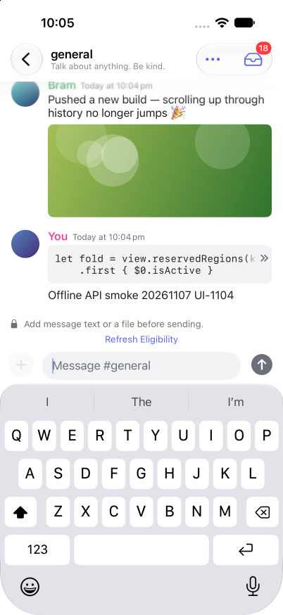
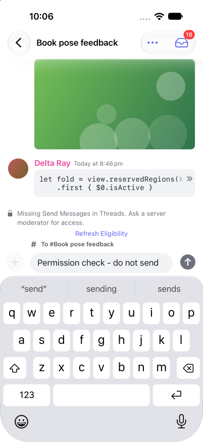

# Capability-aware Discord operations and reliable sends

Implements [#36](https://github.com/saphid/duocord-native/issues/36), following the deep audit of [effect-discord-perms at 1e82626](https://github.com/RhysSullivan/effect-discord-perms/tree/1e8262673279aee6bbc9e6cc3c7f79c659a6f9a4). The useful ideas were implemented independently in Swift. No upstream TypeScript implementation or new runtime dependency was copied. Upstream bot fixtures remain hypotheses for this human-account client.

## Result

- A pending send retains one logical identity, nonce, text, reply, ping choice and files. Confirmed, refused, not dispatched and delivery-unknown outcomes stay distinct. Unknown recovery reads for confirmation and never replays the message POST; a bounded page without a match remains unknown. Explicit refused/non-dispatched retries preserve the original payload. One 45-second budget covers admission, uploads and final request.
- Composer and action dispatch share allowed/denied/unknown capability decisions, actual payload requirements, current ownership/thread/account facts, timeout and scoped human slowmode evidence. Missing metadata cannot create an all-permissions fallback. Drafts survive refusal and eligibility refresh; refreshed facts never automatically send.
- Refusals retain the original Discord error and attempted operation. Read-only attribution is bounded to four seconds, coalesced and protected by account/epoch/entity revisions and tombstones. Code 50001 alone cannot hide readable history, and old REST results cannot overwrite newer gateway facts or revive removed entities.
- Existing edit/delete, reaction, pin and thread state machines retain their optimistic rollback, gateway confirmation, FIFO and session fences. Pin pagination still reaches 103 unique rows. Typed resource IDs and a closed endpoint registry feed transport method/path/bucket and safe diagnostics from one definition.
- The [complete route ledger](../../discord-api-coverage.md) accounts for 35 protocol entries, 34 physical endpoint cases, 40 independently exercised wire entry-point/variant fixtures and the separate signed-storage PUT. It identifies account actions that retain their earlier policies and account-specific semantics that remain unknown.

## Evidence

The final focused worker run passed **479/479**, zero skips, exit 0. Parent verified all 37 frozen hashes and exact staged patch. Compiler-negative probes reject four wrong resource-ID kinds; a roles-route mutation fails the actual wire test. Permission/freshness and lost-response regressions include genuine red and mutation controls.

The full integration run executed **825 methods: 820 passed, three failed, two skipped, exit 65**. All 22 pin tests pass after updating three legacy feedback tests to assert the new detailed refusal and cancelled/obsolete intent policy; no-request and rollback checks remain. All eight remaining failed layout assertions match the prior unchanged-base run. The two skips are iPad-only tests on an iPhone 17 Pro. See [verification](verification.json). The suite is not reported as fully passing.

Fresh independent review task `85c102ff-463f-47d1-a48f-b1ae1434e06a`, actual provider claudeAgent / claude-opus-5-5 / high, failed before review at the API rate limit. No independent findings or approval exist. See [attempt](review-attempt.json). No CODING_STANDARDS.md was found in the current or primary repository.

Astra's offline iPhone 17 Pro UI smoke check confirms ordinary send/draft clearing, one settled matching row, keyboard/composer use and disabled Send with a nonempty draft lacking thread permission. Refresh failure preserves the draft; stock mocks lack successful guild/roles/member refresh fixtures. Delivery-unknown and successful refresh were tested offline at the transport/model seam, not visually. See [UI receipt](ui-verification.json).

## Limits

No live Discord operations or entitlement validation occurred. Some human-account limits remain server enforced or unknown; a bot's message-size or permission observations are not imported as universal guarantees. Outgoing recovery is in memory; process-death persistence is not added. Unknown codes and unexpected refusals remain recoverable without a claimed missing permission. There is no universal deadline or delivery-unknown UI for every existing account action.

The separate [Duo layout/video task #32](https://github.com/saphid/duocord-native/issues/32) remains open. This release does not claim sidebar/fold/rotation/tabletop keyboard/right-edge gesture proof. The dirty primary checkout was preserved.

## Release provenance

Released as **1.0 (202611071106)** from [7de9f48](https://github.com/saphid/duocord-native/commit/7de9f4896caf193d08a632708f1503382fc0e91f). All 89 frozen source inputs match that commit and the archive inputs. Manifest SHA256: `32246336daf69637599faa48a86bb1f79af6568fb284f53cf823aa2eef154641`.

See [manifest](source-manifest.sha256) and [signature/identity checks](archive-verification.json). Apple independently reports **VALID / IN_BETA_TESTING** at 2026-11-07T11:13:06Z for the existing **Alex**, **t3crew** and **DuoCrew** internal groups, with exact notes and assignments verified. Archive/export, upload and sharing each exited 0. The IPA and archived executables remained unchanged after upload. See [availability](availability-readback.json) and [actual command exits](command-exits.json). Exact source is tagged [testflight/202611071106](https://github.com/saphid/duocord-native/tree/testflight%2F202611071106). No production App Store submission, tester invitations or public beta links are in scope.
