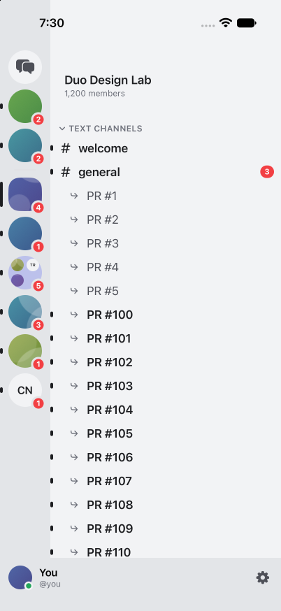
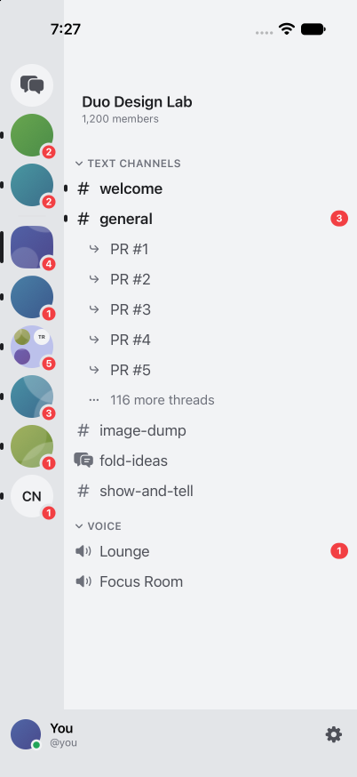
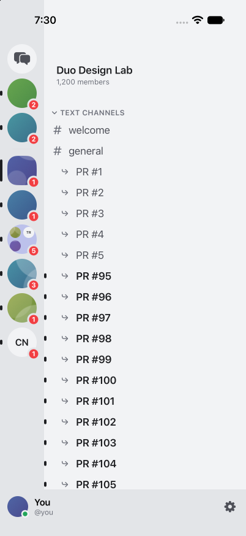
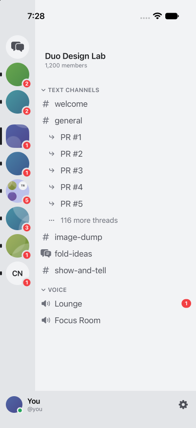
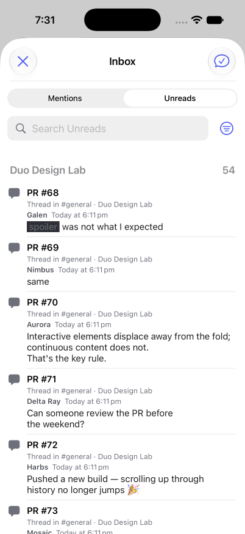
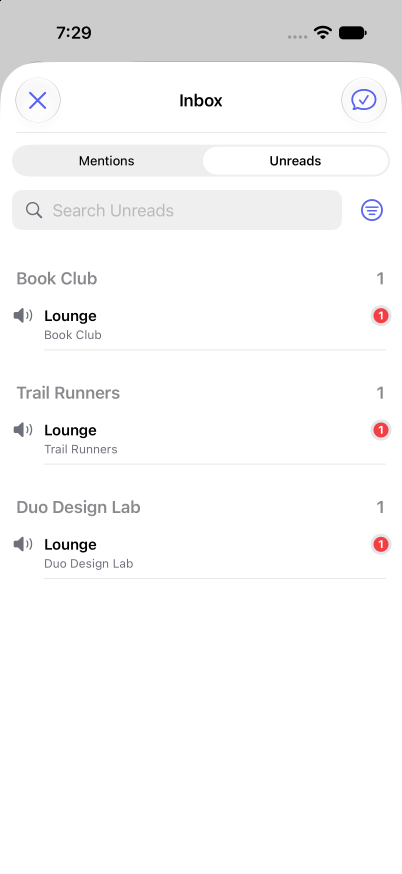

# Bulk read rate-limit proof

Offline iPhone 17 Pro simulator, iOS 27.2. Both builds use 120 generated PR threads and the same Debug mock: one bulk request succeeds, the next receives a 429 without saving it, then its rate-limit window resets. Base `15e6e82` has only the candidate Mock.swift fixture added; candidate includes the fix. GPT-6 Astra/high performed the actual menu actions in both builds.

| Action | Before | After |
| --- | --- | --- |
| Mark Threads as Read | PR #100 onward remains visibly unread | Visible threads clear and collapse; parent #general retains its unread marker and 3 mentions |
| Server Mark as Read | PR #95 onward remains visibly unread | Visible text and thread rows clear |
| Inbox Mark All Read | PR #68 onward remains in Unreads | Visible PR threads clear; only three mock voice Lounge rows remain |

Voice rows have no last-message ID to acknowledge. No candidate error toast appeared in sampled screenshots. Hidden threads were not individually inspected; regression tests verify their saved server state and persistence from READY. Real Discord rate-limit timing and physical devices were not tested.

The fix skips confirmed reads, retains locally advanced reads until server confirmation, and retries only explicitly rate-limited bulk chunks, at most three times with a maximum 30-second wait each. Other writes retain their existing no-retry behavior.

Proof: three original regressions fail on base; two review regressions fail before the local-progress correction. Final verification: 636 tests executed, 635 passed, one skipped, zero failed, excluding three layout tests independently reproduced on clean base. Sol-loop: two GPT-6.1 Sol/high review rounds; S1 (local reads skipped before server confirmation) fixed and approved; no remaining actionable findings. Usage was not exposed. Source diff grew from four files +231/−9 to five files +309/−10 for the correction and its tests.

## Mark Threads as Read

| Before fix | After fix |
| --- | --- |
|  |  |

## Server Mark as Read

| Before fix | After fix |
| --- | --- |
|  |  |

## Inbox Mark All Read

| Before fix | After fix |
| --- | --- |
|  |  |
