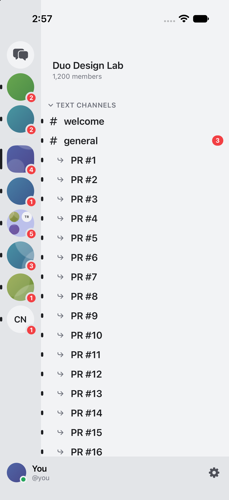
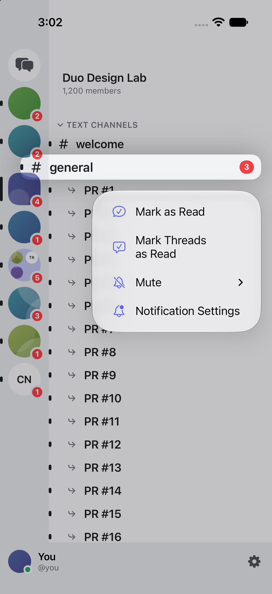
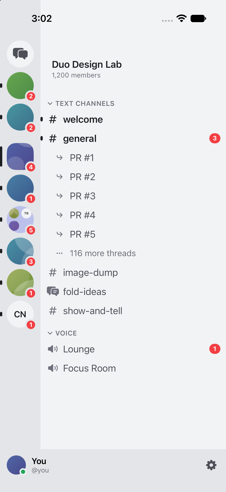

# Large-channel thread read proof

Offline iPhone 17 Pro simulator, iOS 27.2. Fixture: 120 unread PR threads plus an existing child; parent #general has 3 mentions.

- Before: invoking Mark Threads as Read leaves visible threads unread when the simulated endpoint refuses the oversized request.
- After: invoking the same action clears visible thread markers and collapses the list to five read threads plus “116 more threads.” The parent stays unread with 3 mentions.
- Hidden rows were not individually inspected. Regression tests cover all thread read states and persistence from saved server state. No live Discord API or physical-device verification.

Final code passed 621 tests with one skipped and no failures, excluding three layout tests reproduced as baseline failures. Independent GPT-6.1 Sol/high source review approved the four-file fix; GPT-6 Astra/high performed actual simulator interaction. Both new read-state regressions fail against the base implementation.

| Before, after action | Menu | After, fixed |
| --- | --- | --- |
|  |  |  |
