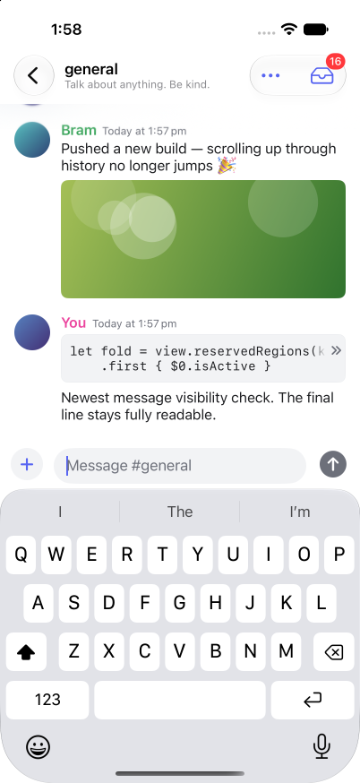
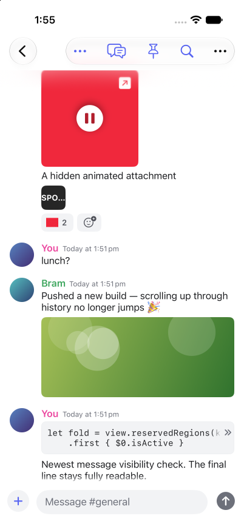
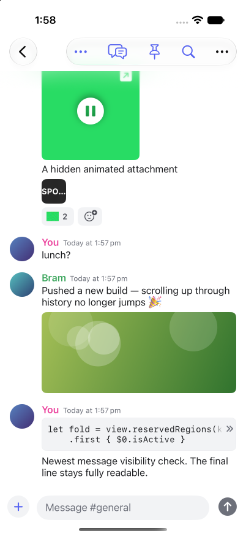

# Composer fade clearance proof

Synthetic MockDiscord conversation on iPhone 17 Pro, iOS 27.2 Simulator, light appearance, 402 × 874 pt. Baseline: `2377a41`. Candidate reserves 14 pt below the newest message to match the composer fade.

With the keyboard shown, the baseline last line loses contrast at its lower edge; the candidate last line remains clear. The same comparison passes with the keyboard hidden. Scrolling upward confirms the fade remains.

| State | Before | After |
| --- | --- | --- |
| Keyboard shown |  |  |
| Keyboard hidden |  |  |

Both builds exited 0. Focused tests: 23 passed, 1 iPad-only skip, 0 failures (ComposerPasteTests, DuoLayoutTests, UIContinuityTests). Independent GPT-6.1 Sol review at high reasoning approved the exact source diff with no actionable findings.

Keyboard hidden-again verification used Back and reopened the conversation; interactive keyboard dismissal was not proved. Duo/table-top, iPad and reaction-only final messages were not visually checked. Clock and fixture timestamps differ between captures. All interactions used a mock account.
