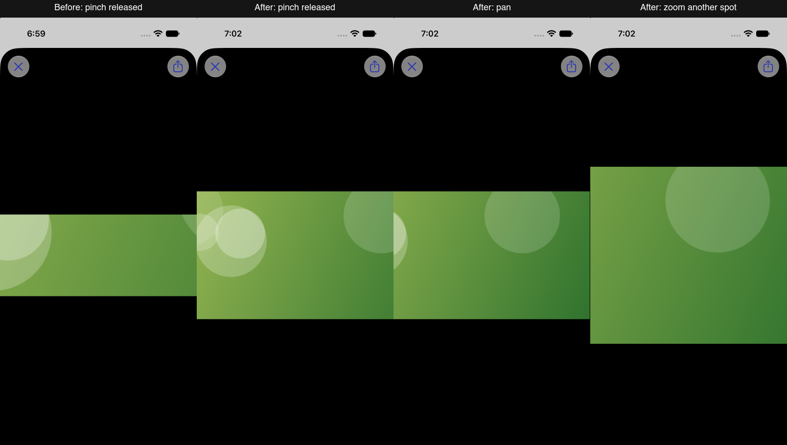

# Persistent image zoom and panning

Fixes [#41](https://github.com/saphid/duocord-native/issues/41).

Opened images previously reset to 1× when a pinch ended. The viewer now uses a native zooming scroll view: zoom persists, one-finger panning moves around the image, and subsequent pinches use the current zoom and touch location. Double-tap toggles between 3× around the touched point and fit; pinching supports 1×–6×. View updates preserve zoom and position, resizing preserves the viewed region, and a different image starts fitted. Existing remote image and animation loading remains in use.

## Observed proof

Verified on iOS 27.2 in the Simulator using the Device panel's agent-device session and fictional demo data. Baseline: open the image in the latest Bram message in #general, pinch outward, release, observe snap-back. Candidate: repeat the same action, observe retained zoom; drag horizontally, observe a different region; pinch again off-center, observe additional retained magnification; double-tap to fit and double-tap near the left side to zoom into that spot. The candidate was rebuilt and installed after the final source edit.

The raw screenshots, gesture recording, build/test logs and result bundles are retained under `build/zoom-proof/` in the task worktree.

## Automated verification

- The hosted `MediaViewer` regression test failed on the original implementation with no zooming scroll view.
- The first focused run passed 26 zoom/media tests.
- Final candidate: 866 tests executed, 2 skipped, 17 assertion failures in seven existing test methods; both new zoom tests and the existing animated-media suites passed.
- Unchanged main at `492831171840ecc26577226d7d36ef42ad270d54`: 864 tests executed, 2 skipped, exactly the same 17 assertion failures in the same seven methods. No candidate-only failures. See [comparison](test-comparison.json).
- Baseline and full-suite test commands returned 65 because of the recorded failures; focused run returned 0. All used the isolated non-T3 Xcode build wrapper and an independently created iPhone 17 Pro simulator. Wrapper-owned temporary DerivedData was cleaned on exit.
- `git diff --check` passed.

## Independent review

Read-only T3 task, Codex provider, GPT-6.1-Sol, high reasoning, completed: no actionable findings in the frozen source diff, new Swift files, generated project additions, relevant callers, and remote/animated loading lifecycle. No `CODING_STANDARDS.md` exists in the task or primary worktree. Exact task ID and reviewed source hashes are in [review.json](review.json).
