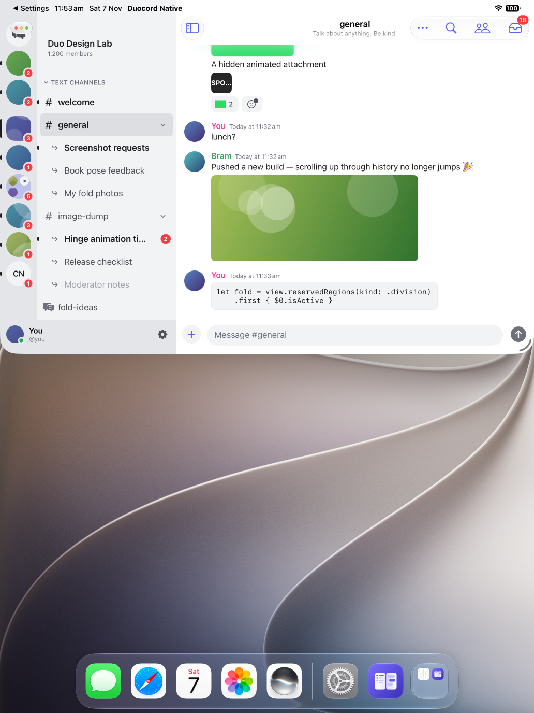
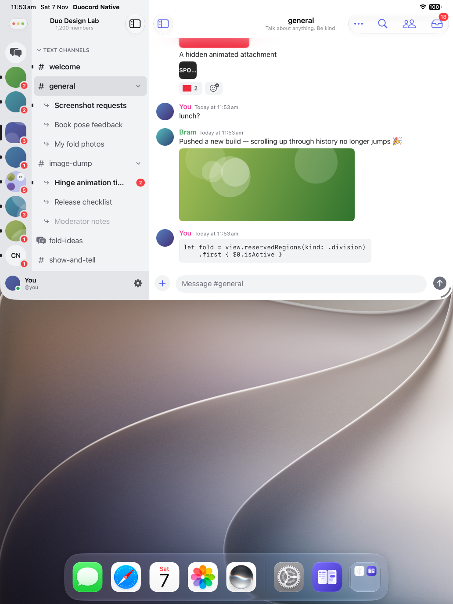

# iPad window controls verification

The iPad sidebar uses its native navigation bar for the server name/member count or Direct Messages title. The rail starts below the bar so OS window controls do not overlap Home; the duplicate custom list heading is removed only in the iPad split view.

## Windowed proof

Synthetic mock content, iPad Pro 13 M5 Simulator, iOS 27.2, Xcode 27.2. Baseline source is 745dcd0; candidate executable source is 77398dc. Both use the same OS Top arrangement (approximately 1032×683 points). Window controls were driven through the supported SpringBoard semantic controls, with fresh screenshots verifying every action.

| Before | After |
| --- | --- |
|  |  |

The traffic-light capsule remains near y43–65. Home moves from approximately y42–90 to y96–144; the native title and 1,200-member subtitle occupy the navigation bar. The custom server heading is absent.

- [Home/Direct Messages](candidate-windowed-home.png): native title and DM list switch correctly; switching back to the server also succeeds.
- [Sidebar hidden](candidate-sidebar-hidden.png) and [revealed](candidate-sidebar-revealed.png): detail toolbar controls hide and restore the rail/list and native title.
- [Narrow detail](candidate-narrow-detail.png) and [narrow sidebar](candidate-narrow-sidebar.png): OS Left arrangement, 511×1253 points; back navigation reveals the rail/list. Snapshot reports navigation bar y32–86, rail origin y86, Home y96–144.

Portrait, normal text size, light appearance, two OS arrangements were checked. Landscape, physical devices, Stage Manager, arbitrary free resize and keyboard behavior were not checked. Mock timestamps, animation colors and typing state differ. No live account or message operations were performed; no private tester media is included.

## Automated evidence and review

- New mounted regression `DuoLayoutTests.testIPadSidebarKeepsHomeBelowNativeHeader` fails on base for missing UINavigationBar (exit 65), passes on candidate (1 test, zero failures, exit 0). Baseline and candidate app builds pass (exit 0).
- Broader iPad run: 683 tests, 681 passed; two methods/three assertions fail (exit 65). The same failures reproduce identically on unmodified base: `testChannelRowsKeepTouchTargetsAtLargerText` and `testComposerSitsJustAboveHomeIndicatorWithKeyboardHidden`.
- Three previously documented baseline layout methods were excluded: `testHiddenSidebarRevealAndTitleSurviveScrolling`, `testHidingSidebarAfterScrollingKeepsReveal`, `testSidebarFooterSitsJustAboveHomeIndicator`.
- Independent source review: Codex, GPT-6.1 Sol, high reasoning, completed APPROVE with no actionable findings in `App/MainView.swift`, `Features/Sidebar/SidebarColumn.swift`, and `Tests/DuoLayoutTests.swift`. Frozen diff SHA-256: `1d2e1f79e528acbc87a4c75d2715f52559e2a61b959e113f05fb325057cd5191`. Opus capacity was unavailable; a different-model review was skipped. Runtime proof was performed by GPT-6 Astra.

Original device discovery, coordinate and session-lock blockers were resolved. The owning automation session closed successfully without shutting down the Simulator. The candidate remains installed and the task device remains available in T3.
