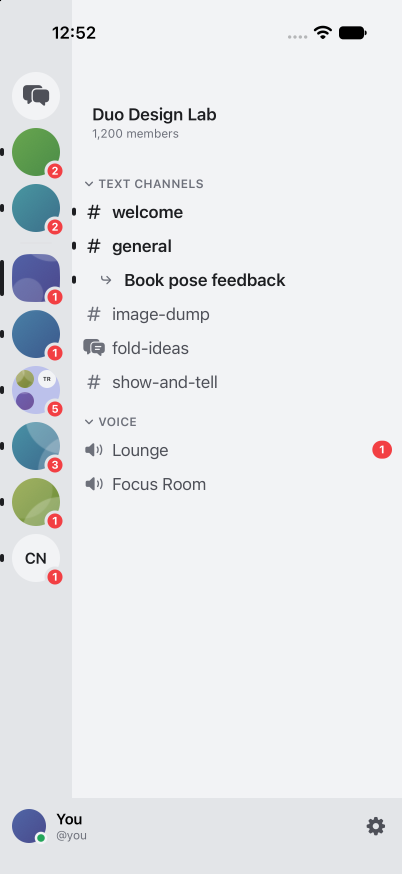
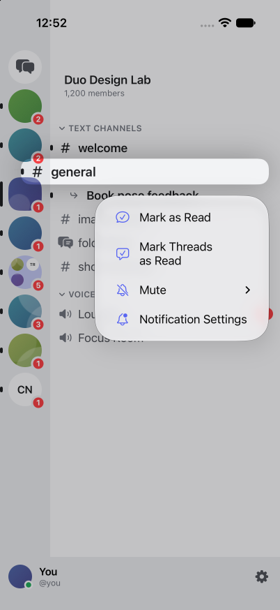
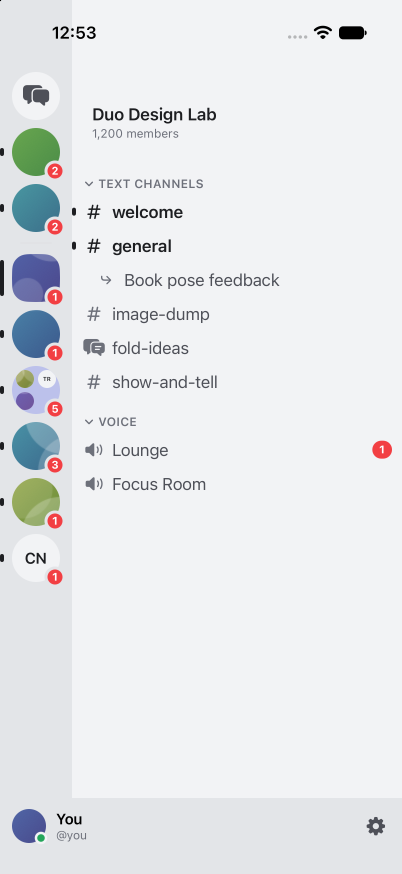

# Mark Threads as Read proof

Offline iPhone 17 Pro simulator, iOS 27.2, Xcode 27.2.

Established the parent channel unread using an older history message while the thread was read, then marked the thread unread. The channel context-menu action clears the child thread while retaining the parent unread indicator. Header action also present; action absent from thread, threadless channel and DM menus. No live Discord writes.

| Before | Menu | After |
| --- | --- | --- |
|  |  |  |

94 read-state, notification and sidebar regression tests passed. Two independent GPT-6.1 Sol reviews on high approved the behavior diff with no actionable findings.
