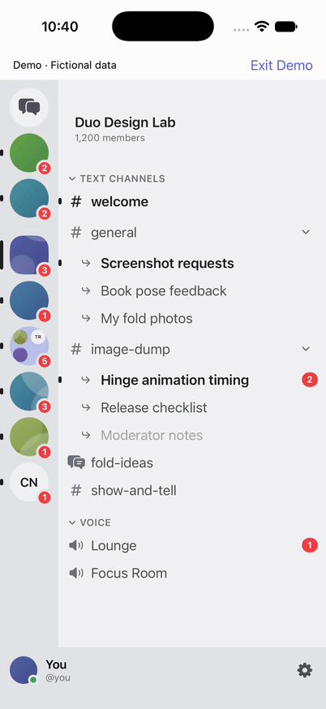

# Final native mock UI proof — PASS

Final `build/server-management/final-products/DuocordNative.app` installed and tested on **local / B8344F4C-70CD-43A9-8FB4-7B5481C11723**, iOS 27.2, 402×874 points. Build receipt is **0**. Independently verified **93/93 frozen input hashes**, then rechecked them after testing. Every installed bundle file matches the supplied artifact. Exported UTI is `com.saphid.duocord.server-move`, conforming to `public.data`; provider visibility is `.all`. Temporary drag logging is absent from the relevant source.

- Manifest SHA-256: `eca31890c58f660713b4adacbf66c586846d0b1b5f73ccd577c4d3866a5b5296`
- Executable SHA-256: `2adb8a788ea0053da96a3524bf55c4524419c2609e4dc6364e5bef02a787a3d3`
- Bundle file-manifest fingerprint: `cb966aa3baaa10098f0706622b5ecad5d99b3a75232e06f3e2c1ea1adef25ed2` (SHA-256 of sorted compact JSON mapping bundle-relative paths to their SHA-256).

## Observed behavior

Both fresh launches showed **Demo · Fictional data**. Native gesture commands used fresh pinned references, **350 ms source hold / 1000 ms movement / 1500 ms destination hold**, and all exited 0. Recordings show lifted native previews and drop indicators; no context-menu Move action was used.

1. **Primary drag passed:** SwiftUI Collective moved before Duo Design Lab. Duo stayed selected.
2. **Named leave and Cancel passed:** “Leave ‘Duo Design Lab’?” appeared; Cancel preserved the complete order, membership and selected Duo server.
3. **Confirmed leave passed:** reopened the named confirmation, confirmed Leave Server; only Duo disappeared. Direct Messages became selected and `dmList` appeared.
4. **Post-leave drag passed:** Book Club moved before SwiftUI Collective. DM selection, other servers, collapsed Hobbies (3 servers), and pinned Cinder/Fjord remained.
5. **Injected reorder failure passed:** fresh `-DuocordMockServerFail YES` launch; native drag displayed **“Couldn’t save server order. Discord returned 403: Missing Permissions”**, retaining the original full order and Duo selection.

Exact visible rail orders (including pinned DMs):

- Initial and failure before/after: Direct Messages → Cinder → Fjord → Duo Design Lab → SwiftUI Collective → Hobbies, 3 servers → Home Lab → Book Club → Coffee Nerds.
- Primary and after Cancel: Direct Messages → Cinder → Fjord → SwiftUI Collective → Duo Design Lab → Hobbies, 3 servers → Home Lab → Book Club → Coffee Nerds.
- After leave: Direct Messages → Cinder → Fjord → SwiftUI Collective → Hobbies, 3 servers → Home Lab → Book Club → Coffee Nerds.
- After post-leave drag: Direct Messages → Cinder → Fjord → Book Club → SwiftUI Collective → Hobbies, 3 servers → Home Lab → Coffee Nerds.

Prior **leave failure** proof is reused with attribution, not represented as a final-artifact rerun: [preserved prior receipt](leave-failure-verification.json), [prior named leave 403](leave-failure.png). The task states that leave behavior's source is unchanged. Prior instrumented successful callback chains are in [differential-proof/RESULT.md](../../../build/server-management/differential-proof/RESULT.md); no new final-build callback logging is claimed.

## Before / After evidence

**Before — earlier failed native drag, before exported-type correction.** Supplied diagnostic recording `build/server-management/drag-diagnosis/attempt1-exact.mp4`, not recaptured. It shows lift/movement and return to original order. Instrumented baseline used 1000/1000/500 ms; final uses 350/1000/1500 ms. This demonstrates behavior, not a timing comparison.

**After — final artifact, successful native drag.** SwiftUI Collective moves before Duo Design Lab; all other visible rail entries remain.

[Continuous primary MP4](drag.mp4) · [Before still](before.png) · [After still](after.png)

[Cancel GIF](leave-cancel.gif) · [Confirm leave GIF](leave-confirm.gif) · [Cancel recording](leave-cancel.mp4) · [Confirm leave recording](leave-confirm.mp4) · [Named confirmation](leave-confirmation.png) · [After leave](after-leave.png)

[Post-leave native drag GIF](post-leave-drag.gif) · [Continuous post-leave MP4](post-leave-drag.mp4) · [Post-leave still](post-leave.png) · [Failure GIF](failure-drag.gif) · [Continuous failure MP4](failure-drag.mp4) · [Named failure still](failure.png)

## Media, execution and limits

Full frame throughout: 402×874 PNG/GIF, 1206×2622 MP4. GIFs derive from actual continuous recordings at **12 fps sampling**, proportional resize and native elapsed timing, with only GIF centisecond rounding. No crops, synthetic compositions or speed changes. Raw recordings retained. Leave GIFs select continuous intervals 0–24 s (Cancel) and 204–214.633 s (confirmation); uncut leave video includes long agent/tool pauses, not measured app latency.

FFprobe durations: baseline 4.305 s; primary 5.377 s; post-leave 5.500 s; failure 5.372 s; leave 214.633 s. Saved smoke recordings show the Back-to-sidebar transition. Recordings decoded sequentially; action/result key frames and final GIF frames were visually inspected at 390 pixels wide, including native lift, drop indication, order change and final failure. No full real-time player playback or smoothness claim. Icon-only rail names are established by paired accessibility snapshots.

Exact commands, outputs and exits: [commands.json](../../../build/server-management/final-ui-proof/commands.json), [media commands](../../../build/server-management/final-ui-proof/media-commands.json). Identity, all 93 hashes, measured orders, assertions, artifact hashes, metadata and limitations: [ui-verification.json](ui-verification.json). Install command: `xcrun simctl install B8344F4C-70CD-43A9-8FB4-7B5481C11723 build/server-management/final-products/DuocordNative.app`, exit 0.

One premature leave-video inspection exited 1 (“not a readable MP4”) while its owned stop/export was still running. Export completed with exit 0; the single inspection retry decoded successfully. A media QA script lacked Pillow; existing FFmpeg performed the frame extraction successfully. Neither was a native product failure.

**Limits:** fictional mock only; no real Discord operations, backend durability, cross-launch persistence, or all-long-hold reliability claim. Fresh mock launches reset the fixture. Hobbies retained by visible count, not expanded contents. No executable source edits, builds, subdelegation, commits, PR actions or uploads. Previous blocked/partial receipts and overwritten media are preserved in `build/server-management/final-ui-proof/prior-receipts`; all diagnostic raw evidence remains.

**Cleanup:** own bound CLI `close com.saphid.duocord` exited 0; own Device panel closed successfully with `shutdown:false`. Simulator remains booted; no other device/session cleanup.

Final receipt check: 12/12 assertions and 16/16 selected media hashes match; all 93 source hashes remain frozen. Parent-owned `verification.json` changed concurrently since startup; this agent did not write or restore it.

Publication: compact real-time leave clips are included with the GIFs; the uncut 214.633-second recording remains in the local proof directory. Other continuous gesture recordings are published in full.
