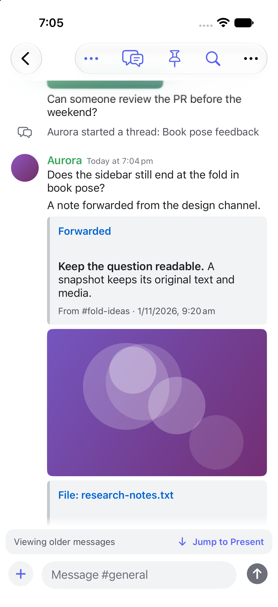
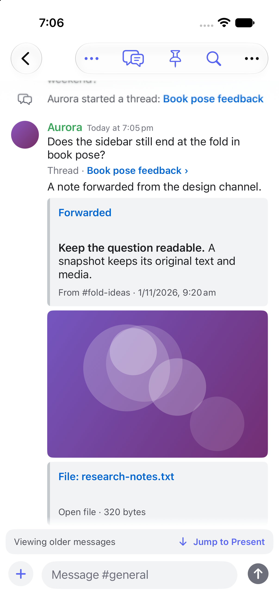

# Parent-channel thread links

Offline mock proof on an iPhone 17 Pro Simulator, iOS 27.2, against base f48b425.

- Before: type-18 thread creation text is grey and untappable; the starter has no thread link.
- After: the system line and starter show blue links. Both were tapped and opened the registered mock thread.
- Regression: 5 of 6 new ThreadLinkTests failed before the rendering fix (exit 65).
- Final full suite: 630 tests, 0 failures, 1 skipped; exit 0.
- An earlier run reproduced three DuoLayout failures on both base and candidate; the final full run passed them.

| Before | After |
| --- | --- |
|  |  |

[System-line destination](after-opened-thread.png) and [starter-link destination](after-starter-opened-thread.png).

The simulator starter uses an embedded thread object pointing to an existing mock thread, rather than sharing its message ID. The real flag-only gateway sequence and matching message/thread IDs are covered by unit tests. Live Discord and unknown archived-thread fetching were not tested or changed.

Independent review: one sol-loop round, Codex provider, GPT-6.1 Sol, high reasoning, completed, APPROVE; no blocker or should findings in the six-file behavior diff. Task: node:delegated-task:command%3Amcp%3Ab2867eed-06c8-45be-8e2e-1ba9ab5883be%3Adelegate-task%3Abd7621a9-ba7e-44c1-9b8d-9248c885e56d. S1 mock identity nit declined to preserve the proved fixture; the flag-only behavior has separate gateway coverage. Usage was not exposed. Behavior diff stayed at 258 additions, 4 deletions across six files. No coding standard file was found in the repository, primary worktree, ancestors, or main.

Full build logs, result bundles and source/runtime reproduction records are retained locally under build/thread-link-fix-20261104 in the task checkout. Temporary DerivedData was cleaned by the build wrapper and the owned simulator was shut down.
